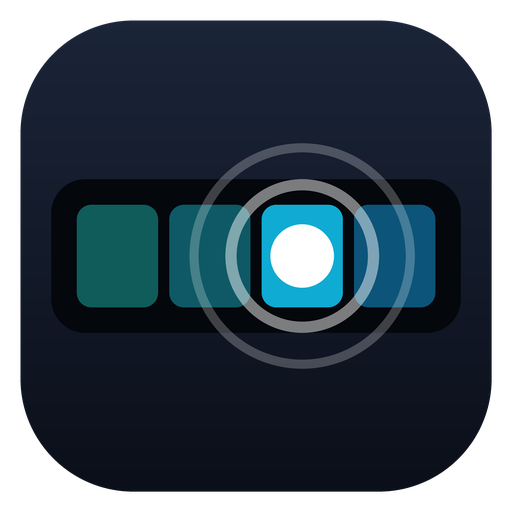

<p align="center">
  
</p>

<h1 align="center">EdgeTouch</h1>

<p align="center">
  Keeps the Windows cursor off your crosshair when you use a touchscreen like the Corsair Xeneon Edge while gaming.
</p>

<p align="center">
  <a href="https://github.com/nihal711/edgetouch/releases/latest">Download</a> ·
  <a href="#how-it-works">How it works</a> ·
  <a href="#building-from-source">Build from source</a>
</p>

---

If you play with a second touchscreen next to your monitor, you've probably run into this: you tap
something on the touchscreen (skip a song, change the volume, hit a Stream Deck-style button) and
when you get back to CS2 the Windows arrow is sitting right on your crosshair. It stays there until
you open and close the game menu.

EdgeTouch sits in the system tray and clears it for you, usually before you notice it was there.

## Download

Get `EdgeTouch.exe` from the [latest release](https://github.com/nihal711/edgetouch/releases/latest).
There's no installer. Put it anywhere and run it, and it shows up in the tray.

- Windows 10 or 11, 64-bit
- About 350 KB, no dependencies
- The exe isn't code-signed, so SmartScreen may warn you the first time. Click **More info**, then
  **Run anyway**. Each release has a SHA-256 checksum next to the exe, and the source is all in
  [`src/EdgeTouch.cpp`](src/EdgeTouch.cpp) if you'd rather build it yourself.

To start it with Windows, tick **Start when I sign in to Windows** in Settings.

## Using it

Click the tray icon to open Settings. Right-click it for a quick menu where you can pause it or
exit.

| Setting | What it does |
| --- | --- |
| Enable EdgeTouch | Turns the fix on or off. The tray icon goes grey while it's paused. |
| Start when I sign in to Windows | Adds EdgeTouch to your startup apps. |
| Treat any fullscreen app as a game | Watches any borderless or exclusive fullscreen window, not just the programs in the list. |
| Also watch these programs | Programs to watch even when they run in a window. `cs2.exe` is there by default. |
| Write a debug log | Records what EdgeTouch sees, which is handy if something isn't working. |

Settings are saved to `%APPDATA%\EdgeTouch\EdgeTouch.ini`.

## How it works

In a match, CS2 locks the mouse to the centre of the screen and hides the cursor. When you touch
an app on the Edge, that app sets the cursor to the normal arrow.

Windows decides which app's cursor to show by checking which window is under the mouse. It only
does that check when the mouse moves over a window. With the mouse locked in place, the check
never happens, so the arrow from the Edge app stays on screen. Opening the menu makes CS2 reset
its cursor, which is why that clears it.

EdgeTouch checks the cursor every 50 ms. When it sees the cursor visible while the game has the
mouse locked, it:

1. lifts the game's cursor clip for an instant,
2. moves the cursor one pixel and straight back, which makes Windows check the game window again,
3. puts the clip back exactly as it was.

The game then applies its own hidden cursor. All of this takes well under a millisecond.

## Anti-cheat

EdgeTouch doesn't do any of the things anti-cheat systems look for:

- It never opens, reads or writes the game's process, and never loads anything into it.
- It installs no keyboard or mouse hooks, so it adds nothing to your input path.
- It never sends keystrokes or clicks. The one-pixel cursor move uses `SetCursorPos`, which
  doesn't produce raw input, so it can't affect your aim.
- The cursor clip it lifts is a desktop-wide Windows setting that Windows itself resets every
  time you alt-tab.

That said, nobody outside Valve can promise anything about VAC, so use your own judgement.

## Troubleshooting

If the arrow still shows up:

1. Open Settings, tick **Write a debug log**, and click **Save**.
2. Reproduce the problem once.
3. Click **Open log folder** and look at `EdgeTouch.log`, or attach it to an
   [issue](https://github.com/nihal711/edgetouch/issues).

The log shows which window was in front, when the cursor appeared and disappeared, and what
EdgeTouch did about it.

## Building from source

Visual Studio 2022 with the "Desktop development with C++" workload, plus CMake 3.20 or newer:

```
cmake -S . -B build -A x64
cmake --build build --config Release
```

The exe ends up in `build\Release\EdgeTouch.exe`.

It also cross-compiles from Linux or macOS with [Zig](https://ziglang.org):

```
zig c++ -target x86_64-windows-gnu -O2 -std=c++17 -Isrc src/EdgeTouch.cpp src/EdgeTouch.rc \
  -o EdgeTouch.exe -luser32 -lshell32 -ladvapi32 -lgdi32 -lcomctl32 -lcomdlg32 \
  -Wl,--subsystem,windows -s
```

Every push is built on GitHub Actions. Publishing a release on GitHub builds the exe and attaches
it, along with its SHA-256 checksum.

## License

[MIT](LICENSE)
